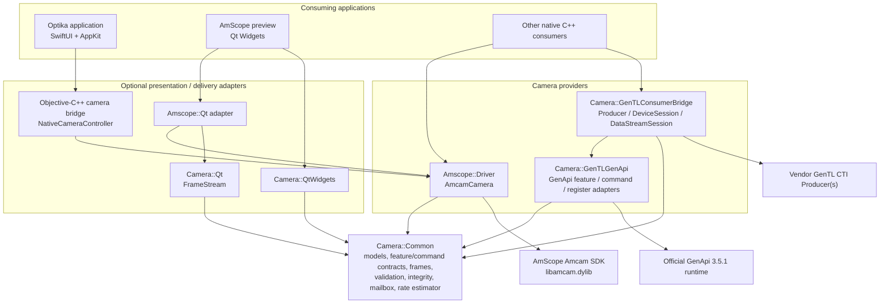
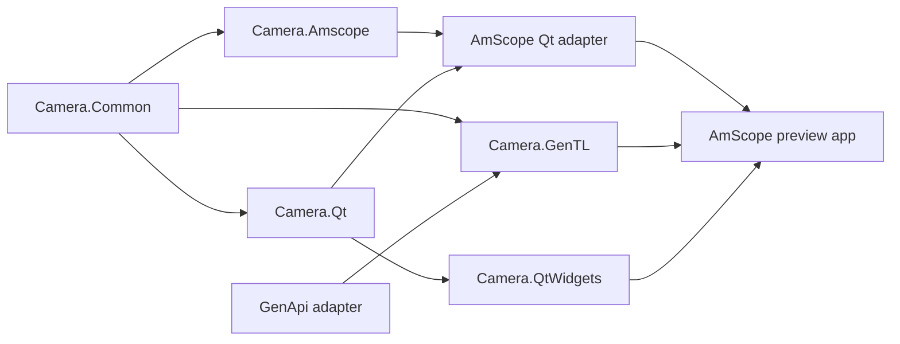
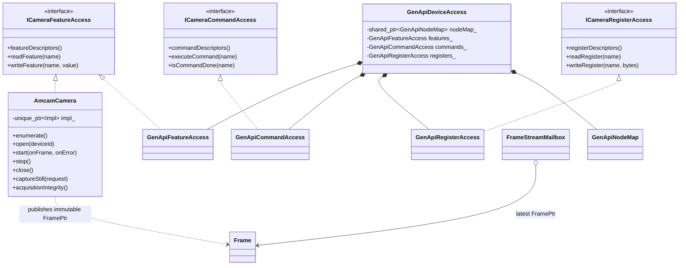
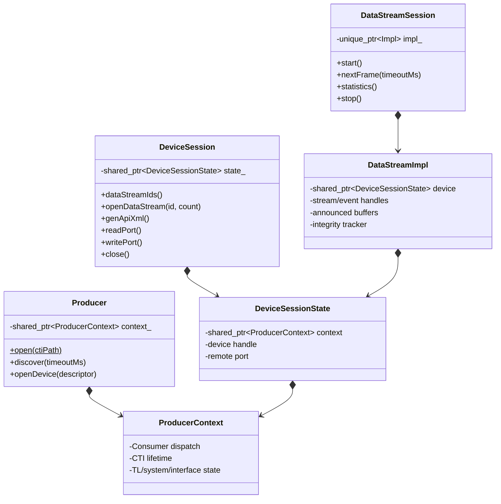
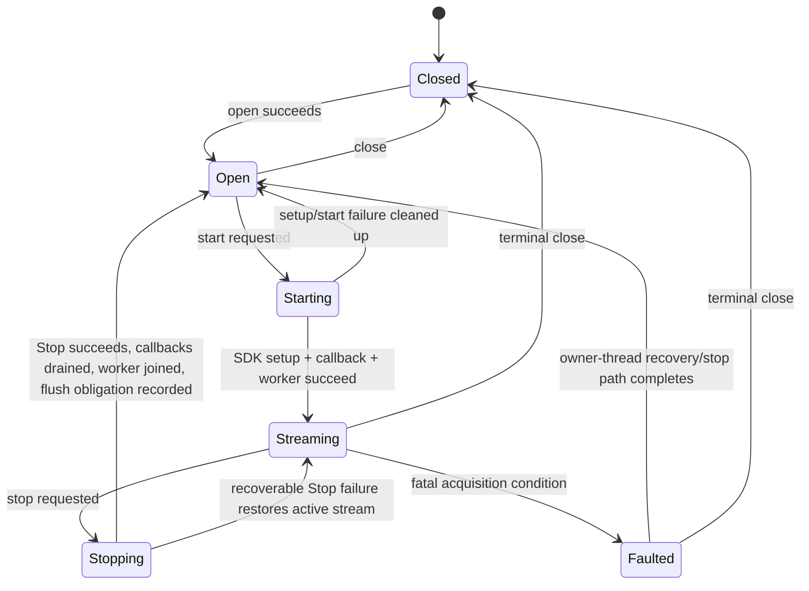
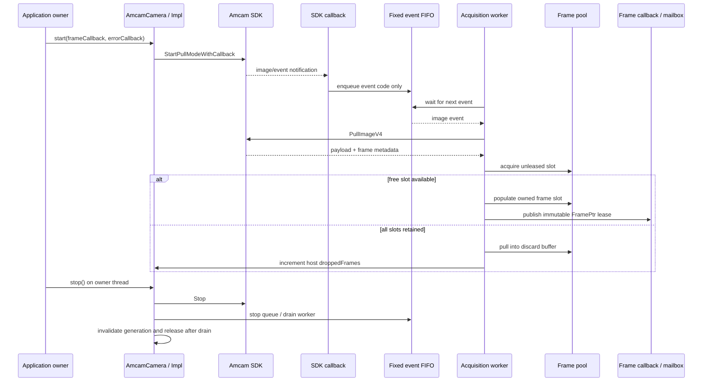
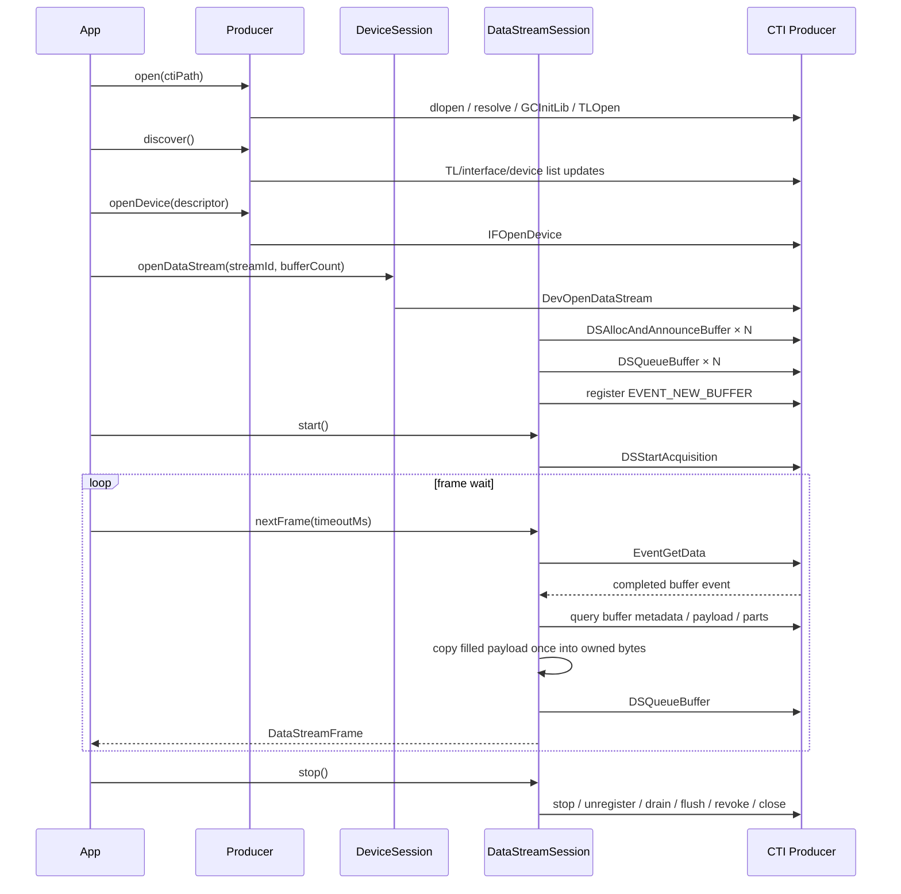

# Camera Module v2.0 — Architecture, OOP, Runtime and Engineering Reference

**Repository:** `Shennagyp/MICROSCOPE_CPP`  
**Branch:** `camera-v.2.0`  
**Documentation baseline:** 27 November 2026  
**Source snapshot inspected:** branch HEAD `f2ec068ee0150a953b0749d856b8d3a72bd1152a`  
**Language:** C++17 for the reusable camera libraries; Qt 6 for optional streaming/UI libraries; Swift/Objective-C++ for the separate Optika application integration.  
**Purpose:** describe the implemented camera system, its ownership model, APIs, execution paths, memory semantics, test evidence, constraints and remaining qualification work.

This document describes the source present on the branch at the snapshot above. It distinguishes implementation from test evidence and hardware qualification. A class or feature being present in source does not by itself establish that every camera model supports it.

---

## 1. Executive architecture

The Camera Module is a reusable C++ camera subsystem with two independent acquisition providers:

1. **AmScope / Amcam** — a native provider that owns the vendor SDK session and uses the Amcam callback/pull acquisition mechanism.
2. **GenTL** — a native C++ GenTL Consumer that dynamically loads vendor CTI Producer libraries and manages transport-layer, interface, device and data-stream lifecycles. Optional GenApi 3.5.1 adapters expose XML-described device features, commands and public registers.

Both providers reuse **Camera.Common** where their semantics genuinely match: camera identity/capability metadata, typed feature access, commands, immutable frame representation, frame delivery accounting and latest-frame handoff. The common layer does not force the providers to share their internal session state machines, SDK errors, transport identifiers, timestamps or buffer ownership models.

Optional frontend layers are separate:

- **Camera.Qt** — Qt Core notification/handoff adapter over the common frame mailbox.
- **Camera.QtWidgets** — reusable Qt Widgets for frame viewing and camera controls.
- **Amscope::Qt / amscope_preview** — optional AmScope Qt adapter and preview application.
- **Optika SwiftUI/AppKit integration** — an application-level consumer of the native C++ driver. It is not part of Camera.Common and does not move microscope, slide or WSI orchestration into the camera library.

### 1.1 System context



The diagram shows dependency direction, not one mandatory executable. A consuming application chooses the provider and optional frontend components it needs. A process may build multiple providers, but one physical camera session must still have one owner.

### 1.2 Architectural invariants

- One AmScope open session owns exactly one `HAmcam` handle.
- One GenTL Producer context owns its TL/Consumer state; device and stream sessions retain the context they need.
- GenApi feature, command and register adapters for one device share one `GenApiNodeMap`, remote port and serialization boundary when composed through `GenApiDeviceAccess`.
- Camera.Common contains no Qt, Swift, AppKit, microscope, stage, slide, WSI, stitching or image-processing dependency.
- Vendor SDK and CTI calls stay behind their provider implementations.
- Frame payload bytes and their metadata are preserved; unknown formats are opaque rather than guessed.
- Preview delivery is latest-frame-wins and bounded. It is not a lossless WSI tile archive.
- A successful write/readback is stronger evidence than a UI editor or a model flag. Availability, readability and writability are separate.
- Settings, commands, telemetry and lifecycle operations remain distinct concepts.
- Optional Qt and GenApi dependencies remain opt-in at build/package time.

---

## 2. Repository map and ownership

### 2.1 Library layout

| Path | Responsibility | Public entry points / targets |
|---|---|---|
| `Camera/Common` | Backend-neutral contracts and primitives | `Camera::Common` |
| `Camera/Amscope` | Native Amcam provider, model profiles, acquisition, features and accessory operations | `Amscope::Driver` |
| `Camera/GenTL` | GenTL 1.6 Consumer, CTI loader, Producer/device/stream sessions, frame adapter | `Camera::GenTLConsumerBridge` |
| `Camera/GenTL` (optional GenApi) | GenApi XML node map and feature/command/register access | `Camera::GenTLGenApi` |
| `Camera/Qt` | Qt Core frame delivery adapter | `Camera::Qt` |
| `Camera/QtWidgets` | Reusable Qt camera widgets | `Camera::QtWidgets` |
| `Camera/VendorSDK/AmscopeVendorSDK` | Bundled vendor headers, libraries, documentation and samples | External SDK input; not a Common dependency |
| `Application/OptikaB293` | Separate SwiftUI/AppKit microscope application and C++ camera bridge | Application executable |
| `docs/architecture` | Architecture, status, integration, ownership and handoff records | Documentation |
| `Camera/tests/consumers` | Installed-package external consumer fixtures | CI/test-only |

### 2.2 Dependency rules



- `Camera::Common` is the base contract.
- AmScope links Common and the Amcam vendor runtime. The driver itself is C++17 and non-Qt.
- GenTL links Common and uses the platform dynamic loader for CTI libraries.
- GenApi is optional and adds the official GenApi SDK/runtime dependency.
- Qt Core, Qt Widgets and the AmScope Qt adapter are independent optional components.
- The AmScope preview executable can include the GenTL catalog for combined diagnostics, but its interactive camera-control/acquisition path remains AmScope-specific. Seeing a GenTL device in `--list-cameras` does not mean the AmScope preview can open that device.

### 2.3 What is outside the camera library

The camera library ends at camera discovery, session lifecycle, acquisition, frame representation, camera features/commands and transport/acquisition telemetry.

The following belong to the Optika/microscope application or other libraries:

- Microscope optical/mechanical hardware model and light-path composition.
- Objective selection and optical resolution policy.
- Stage/controller drivers, coordinate transforms, slide/rack geometry and homing.
- Slide identity, sample type, stain metadata and operating-mode recommendation.
- Tile scheduling, WSI coverage, tile acceptance, retry policy and durable image storage.
- Stitching, registration, image processing, GPU processing and final slide reconstruction.
- User workflow and persistence of microscope/slide projects.

The camera can report a missing frame ID or incomplete buffer. It does not decide whether a WSI tile is accepted, recaptured or committed to a slide scan.

---

## 3. Camera.Common — shared contracts

Camera.Common is intentionally small in responsibility, but it defines the semantics that both providers must preserve.

### 3.1 Camera identity and capabilities

Primary types:

- `camera::ImageResolution`
- `camera::CameraIdentity`
- `camera::CameraCapability`
- `camera::CapabilityStatus`
- `camera::CameraCapabilities`
- `camera::CameraDeviceInfo`

Identity fields are optional because provider discovery APIs expose different data. An enumeration ID is an opaque routing token; it is not assumed to be a serial number or stable across disconnect/replug.

Capability status is tri-state:

- `Supported`: there is positive model/provider evidence.
- `Unsupported`: the capability is known to be absent.
- `Unknown`: evidence is absent or incomplete.

Unknown must not be silently converted into Unsupported or Supported. A UI may display “not reported” rather than a fabricated negative.

```cpp
camera::CameraDeviceInfo info;
info.id = opaqueIdFromProvider;
info.displayName = discoveredName;
info.identity.model = modelIfKnown;

info.capabilities.set(
    camera::CameraCapability::VideoAcquisition, true);

switch (info.capabilities.status(
            camera::CameraCapability::RawPixelOutput)) {
case camera::CapabilityStatus::Supported:
    // Model/provider evidence says RAW output is supported.
    break;
case camera::CapabilityStatus::Unsupported:
    // Known unsupported.
    break;
case camera::CapabilityStatus::Unknown:
    // Do not infer support or lack of support.
    break;
}
```

Provider-specific model flags, transport codes, speed/fan levels and accessory counts remain in provider-specific types.

### 3.2 Typed feature access

`camera::ICameraFeatureAccess` represents settings and readable/writable device values.

Core types:

- `CameraFeatureKind`: Boolean, Integer, IntegerVector, FloatingPoint, String, Enumeration.
- `CameraFeatureValue`: typed variant of those values.
- `FeatureEnumeration`: explicit enumeration symbol wrapper.
- `CameraFeatureDescriptor`: name, display name, type, unit, availability, readability, writability, range/cardinality, enumeration choices, group, discrete integer choices and disabled reason.
- `CameraFeatureAccessError`: typed failure classification and native code.

The interface is:

```cpp
class ICameraFeatureAccess {
public:
    virtual ~ICameraFeatureAccess() = default;

    virtual CameraFeatureResult<std::vector<CameraFeatureDescriptor>>
    featureDescriptors() = 0;

    virtual CameraFeatureResult<CameraFeatureValue>
    readFeature(std::string_view name) = 0;

    virtual CameraFeatureResult<std::monostate>
    writeFeature(
        std::string_view name,
        const CameraFeatureValue& value) = 0;
};
```

Semantics:

1. A descriptor may be unavailable, read-only, write-only or read/write. These states are not interchangeable.
2. A feature name is consumed synchronously. If an implementation queues work, it must copy the string before returning.
3. The variant alternative must match the descriptor kind.
4. Integer values and ranges stay in `int64_t`; do not round integer limits through `double`.
5. Integer and floating-point ranges use different range types.
6. Enumeration values are symbols, not arbitrary strings.
7. Discrete integer values (such as exact sensor significant-bit choices) are explicit options, not a continuous numeric interval.
8. A write is not considered applied merely because the request was submitted. The provider must report acceptance and perform readback when the feature contract requires it.

Example:

```cpp
auto descriptors = camera.featureDescriptors();
if (auto* list =
        std::get_if<std::vector<camera::CameraFeatureDescriptor>>(
            &descriptors)) {
    for (const auto& feature : *list) {
        if (!feature.isAvailable)
            continue;

        if (feature.isReadable) {
            auto value = camera.readFeature(feature.name);
            // Interpret the returned variant or typed error.
        }
    }
}
```

### 3.3 Commands are not features

`camera::ICameraCommandAccess` represents actions. A command is not a Boolean feature and must not be presented as a persistent setting.

```cpp
class ICameraCommandAccess {
public:
    virtual ~ICameraCommandAccess() = default;

    virtual CameraCommandResult<std::vector<CameraCommandDescriptor>>
    commandDescriptors() = 0;

    virtual CameraCommandResult<std::monostate>
    executeCommand(std::string_view name) = 0;

    virtual CameraCommandResult<bool>
    isCommandDone(std::string_view name) = 0;
};
```

`executeCommand()` means the command was issued. It does not promise that an asynchronous device operation has completed. `isCommandDone()` is a separate observation.

The GenApi adapter implements this interface. AmScope also exposes native command/accessory methods with Amcam-specific preconditions and completion/state structures; those are not silently forced into GenApi semantics.

### 3.4 Raw register access is a third contract

`camera::ICameraRegisterAccess` handles opaque byte registers, separate from scalar feature access.

- A register is a byte sequence, not an inferred integer.
- No byte order, bit-field structure or scalar interpretation is guessed.
- The default transfer bound is 16 MiB.
- GenApi register writes require exact `IRegister::GetLength()` byte count.
- Read/write access is enforced.
- Only public GenApi `IRegister` nodes reachable from Root are exposed; internal `IntReg` implementation nodes are not.

### 3.5 Frame data contract

Primary types:

- `camera::Frame`
- `camera::FramePtr = std::shared_ptr<const Frame>`
- `PixelFormat`, `PixelByteOrder`, `PixelColorFilterArray`, `PixelPacking`
- `PixelFormatIdentifier`
- `FrameTimestamp`, `FrameExposure`
- `FramePart`

A `Frame` preserves:

| Field | Meaning |
|---|---|
| `width`, `height` | Raster dimensions when known |
| `strideBytes` | Bytes per row including row padding |
| `imageOffsetBytes` | Offset from payload base to first image byte |
| `rowPaddingBytes` | Padding at the end of each row |
| `trailingPaddingBytes` | Padding after the image rows |
| `pixelFormat` | Commonly understood storage representation (RGB24, Raw8, Raw16, Unknown) |
| `pixelByteOrder` | Byte order for multi-byte samples when known |
| `pixelColorFilterArray` | Bayer mosaic pattern independent of storage format |
| `pixelPacking` | Packed PFNC sample layout when known |
| `pixelFormatIdentifier` | Original identifier and namespace, e.g. `pfnc` or `amcam.fourcc` |
| `significantBitsPerPixel` | Significant source precision |
| `storageBitsPerPixel` | Container/storage width |
| `isStill` | Still versus live frame |
| `isMultipart`, `parts` | Multipart payload and byte-range views |
| `sequenceNumber` | Optional source sequence value; zero can be valid |
| `timestamp` | Optional ticks, frequency and optional clock domain |
| `exposure` | Optional per-frame exposure ticks and frequency |
| `pixels` | Complete owned payload bytes |

The key accessors preserve different meanings:

```cpp
const std::uint8_t* payloadBase = frame.data();
const std::uint8_t* firstImageByte = frame.imageData();
const std::size_t completePayloadBytes = frame.byteSize();
const std::uint8_t* partBytes = frame.partData(frame.parts.at(0));
```

- `data()` and `byteSize()` describe the complete payload.
- `imageData()` applies `imageOffsetBytes` without creating another buffer.
- `partData()` validates and addresses a part's range inside the same payload.
- Bayer RAW remains RAW. The camera module does not demosaic.
- Significant sensor precision is not the same as storage container width.
- A present sequence/timestamp value of zero is valid. Metadata absence is represented by `std::nullopt`.

### 3.6 Acquisition integrity and rate estimation

`camera::AcquisitionIntegrityTracker` is bounded-memory observation/accounting, not an acquisition scheduler or tile acceptance policy.

It tracks:

- Observed buffers.
- Complete images.
- Incomplete buffers.
- Non-image payloads.
- Invalid/empty payloads (the exact mapping is adapter-specific).
- Host frame-wait timeouts.
- Provider-reported buffer starvation.
- Buffers without sequence metadata.
- Sequence gaps and missing-frame count.
- Duplicate IDs.
- Out-of-order IDs.
- Ambiguous backwards transitions.
- Declared counter wraps.

A sequence counter model has a modulus and minimum value. If no wrap rule is known, a backwards transition is ambiguous; the tracker does not guess that it is a wrap or a number of missing frames.

`camera::FrameRateEstimator` computes a smoothed host-arrival rate from monotonic timestamps. It is not the configured camera FPS and not the vendor's own frame-rate telemetry.

### 3.7 Latest-frame mailbox

`camera::FrameStreamMailbox` is a single-slot atomic latest-frame mailbox:

- It owns no camera, session, worker, event loop or UI.
- Producers may publish from acquisition threads.
- Each publication validates a session generation before and after atomic replacement.
- A stale generation attempts compare/exchange cleanup so it cannot erase a newer frame.
- A notification-pending latch coalesces notifications.
- The consumer atomically takes the newest frame, clears the latch and re-arms if a newer frame arrived during consumption.

It intentionally replaces older preview frames when the consumer is slower. It is not a lossless FIFO and must not be used as the durable WSI tile queue.

---

## 4. OOP model and ownership graph

The implementation uses interfaces at backend boundaries and concrete PImpl/session objects at the provider edges. It does not attempt to force all camera backends into one universal lifecycle base class.

### 4.1 Common interface and provider relationships



The GenApi adapters are composed by `GenApiDeviceAccess` over a shared node map. The AmScope class implements feature access directly while retaining Amcam-specific lifecycle and accessory operations on its concrete public API.

### 4.2 GenTL session ownership



Important lifetime rule: a stream retains the device state it needs; the device state retains the Producer context. Destroying a wrapper does not unload a CTI while dependent handles remain live. If cleanup fails, the implementation quarantines the native context rather than unloading code while Producer handles or callbacks may still exist.

### 4.3 AmScope PImpl ownership

`AmcamCamera` owns a private `Impl` via `std::unique_ptr`. The implementation owns the vendor handle and coordinates:

- Native SDK calls and their serialization.
- Session state and lifecycle mutex.
- Callback context and callback in-flight tracking.
- Bounded event queue.
- Single acquisition worker.
- Four reusable frame slots and a discard path.
- Acquisition generation/frame gate.
- Frame-cache flush obligation.
- Watchdog state and trigger-heartbeat state.
- Still-capture synchronization and feature/profile data.
- Common acquisition-integrity tracker.

The public header does not expose vendor SDK function pointers or the implementation structure.

---

## 5. AmScope / Amcam provider

### 5.1 Public surface

Primary public headers:

- `amscope/AmcamCamera.h`
- `amscope/CameraTypes.h`
- `amscope/AmcamCameraProfiles.h`

The public class offers:

- `enumerate()`
- `open(deviceId)`
- `start(onFrame, onError)`
- `stop()`
- `close()`
- `state()`
- `droppedFrames()`
- `framesPulled()`
- `imageEventsReceived()`
- `acquisitionIntegrity()`
- `featureDescriptors()`, `readFeature()`, `writeFeature()`
- Still capture and camera-specific command/accessory operations.

AmScope-specific types remain in `namespace amscope`: `CameraInfo`, `CameraError`, `CameraState`, `AmcamFrame`, trigger/I/O/accessory structures, lens state, still capture request and Amcam exposure modes.

### 5.2 Session state machine



The state machine is AmScope-specific. Do not copy it into GenTL or create a false common lifecycle enum.

### 5.3 Acquisition sequence

The production path is:



Detailed rules:

1. The vendor callback only enqueues relevant event codes into an allocation-free fixed-capacity FIFO of 256 entries.
2. One C++ acquisition worker consumes events and calls `Amcam_PullImageV4`.
3. The callback does not pull a frame, stop or close the camera, invoke UI code, or release callback-owned resources.
4. Queue overflow is explicit and fatal; the queue does not grow without bound.
5. `E_PENDING` is treated as a transient callback/frame-readiness race.
6. Disconnect, generic SDK error, no-frame timeout, no-packet timeout and event-queue overflow are fatal acquisition conditions.
7. The video watchdog uses the greater of 5 seconds or three times the last known exposure plus 1 second. Only a successfully pulled frame resets the video frame deadline.
8. Triggered modes use the SDK hardware heartbeat event so a valid idle interval with no trigger is not misclassified as a stalled camera. Trigger mode saves/suppresses the SDK no-frame/no-packet timeout options, enables heartbeat subscription and restores prior values when returning to video mode or closing.
9. Stop and Close are never called from the vendor callback/acquisition worker callback context. Public frame/error callbacks run on the acquisition worker; they must queue lifecycle and destruction to the owner/control thread.
10. A successful Stop shuts down event delivery, drains callback activity, joins the worker and preserves the required cache-flush obligation.
11. A failed user Stop while Streaming preserves the active session and callback/frame state; the frame gate can be reactivated for the same acquisition after a recoverable failure.
12. Terminal Close is independent of Stop/flush success.

### 5.4 Buffer pool and leases

The AmScope provider uses four reusable frame buffers. Each published frame is an immutable `FramePtr` lease.

A pool slot is reusable only when the pool owns its sole `shared_ptr` reference. If consumers retain every slot, the acquisition worker continues pulling into a private discard buffer and increments `droppedFrames()`; it does not block waiting for a renderer or mutate memory still visible to a consumer.

The pool's host-side dropped-frame counter is distinct from device/SDK sequence gaps and from GenTL Producer underruns.

### 5.5 Generation gate and stale publication

`AcquisitionFrameGate` binds a frame publication to one active session generation. A Stop/Close or newer session invalidates the prior generation. Publication is accepted only for the active generation. This prevents delayed callbacks from an earlier acquisition from making stale frames visible after a restart.

The common mailbox also validates generation before and after its atomic store. The two checks protect different ownership boundaries: AmScope gates its acquisition callback/session; the mailbox protects the shared presentation handoff.

### 5.6 Frame-cache flush obligation

Every successful Amcam Stop creates a required cache flush obligation using `AMCAM_OPTION_FLUSH`. If the SDK rejects the flush, the obligation remains pending and is retried before the next Start. Generation accounting prevents a newer obligation from being accidentally cleared by an older in-flight flush attempt.

Terminal Close does not depend on a successful Stop or cache flush.

### 5.7 RAW and processed frame semantics

- Processed live frames are packed RGB24, with `strideBytes = width * 3`.
- RAW live mode queries the sensor FourCC/significant precision through `Amcam_get_RawFormat` and separately queries the storage container through `AMCAM_OPTION_BITDEPTH`.
- RAW storage is one byte per pixel for 8-bit container mode or two bytes per pixel for 16-bit container mode, with no row padding in the current adapter.
- The common frame records significant depth separately from storage width.
- Amcam RAW identifiers use `amcam.fourcc`; they are not relabelled as PFNC.
- RAW payload bytes are not unpacked, rearranged or demosaiced by the camera provider.
- The common `RawOutputBitDepth` feature is an integer feature with exact discrete significant-bit choices derived from the live SDK pixel-format enumeration. The provider maps a selected depth to a supported SDK pixel-format code and verifies readback. It does not invent intermediate depths.
- If the SDK cannot enumerate the supported pixel formats, the provider does not pretend that a legacy 8-bit/maximum switch is a complete arbitrary precision selector.
- A RAW frame must not be passed to an RGB888 renderer without an explicit decoder.

### 5.8 Features, profiles and capabilities

The provider exposes a large descriptor-driven feature surface spanning exposure, gain, white balance, color correction, pixel format/RAW output, resolution, frame rate/speed, image processing, sensor, thermal, transport and hardware facts where the SDK/model supports them.

`AmcamCameraProfileRegistry` applies exact model-code allow/deny policy:

- A missing profile imposes no additional restriction.
- A present profile is an allow-list.
- Deny entries take precedence.
- Profiles can narrow SDK-probed capability; they cannot fabricate hardware support.

Model metadata, non-mutating SDK probes, profile policy and current runtime state are separate inputs. A model flag alone does not prove that a feature can be read or written in the current camera state.

### 5.9 AmScope command and accessory surface

The concrete AmScope API includes operations for:

- One-shot auto white balance.
- Trigger configuration and software-trigger bursts.
- GPIO/I/O line state and transactional stopped-state configuration with readback/rollback.
- Embedded light-source state/level.
- Filter-wheel state and asynchronous move request.
- ST4 guide pulses and state.
- Astro auto-focuser state, move and halt.
- Lens focus state, manual focus position and aperture index.
- Still-resolution enumeration and still capture while live acquisition remains active.

These are hardware-specific operations. Their units, enumerations, preconditions and asynchronous completion observations stay in AmScope types rather than being flattened into generic booleans.

---

## 6. GenTL 1.6 provider

### 6.1 Transport stack and native CTI loading

GenTL and GenApi solve different problems:

- **GenTL** is the transport-layer ABI for Producer discovery, device access, data streams, buffers and events.
- **A CTI Producer** is a vendor/transport implementation of the GenTL exports.
- **The GenTL Consumer** is the application-side implementation that loads and calls the CTI.
- **GenApi** parses the device's XML feature description and maps typed feature operations to the device's register port.

The production C++ route is:

```text
Producer::open(ctiPath)
    -> GenTLProducerLibrary::load(ctiPath)
    -> dlopen + required GenTL symbol resolution
    -> Consumer dispatch table
    -> Producer / DeviceSession / DataStreamSession
    -> Camera.Common Frame and integrity contracts
```

`GenTLProducerLibrary` is the native C++ Consumer boundary. It resolves required GenTL 1.6 exports. GenTL 1.5 multipart functions `DSGetNumBufferParts` and `DSGetBufferPartInfo` are optional; a Producer without them can still load for ordinary single-part acquisition.

`ConsumerBridge` remains an explicit optional bridge-injection route for alternative consumers and boundary tests. The normal `Producer::open(ctiPath)` route does not require a separately deployed Swift runtime or an external Consumer C ABI dylib.

### 6.2 Producer discovery

`ProducerCatalog::discoverDevices()`:

1. Reads `GENICAM_GENTL64_PATH` (colon-separated directories on macOS/UNIX).
2. Scans for `.cti` Producer libraries.
3. Canonicalizes and deduplicates paths.
4. Attempts each Producer independently.
5. Records per-Producer failures without suppressing devices discovered from other Producers.
6. Returns entries that retain the exact Producer instance used for discovery.

A catalog entry's `DeviceDescriptor` must be opened through that entry's retained `producer`. The descriptor contains Producer path, interface ID and device ID routing identity. `openDevice()` rejects a descriptor from another Producer, a stale/unretained interface or an unknown device ID.

A scan returning zero devices is a valid result when no Producer is installed or no camera is connected. A failed CTI is reported separately from a successful empty discovery.

### 6.3 GenTL OOP hierarchy

- `Producer` owns shared Producer/TL context.
- `DeviceSession` owns one device-session state and remote-port access.
- `DataStreamSession` owns one stream state, event registration and announced buffers.
- The stream retains the device state; the device state retains Producer context.
- Session wrappers are move-only; internal shared ownership keeps dependent handles alive through teardown.

### 6.4 Data-stream acquisition sequence



The implementation:

- Allocates and announces a bounded buffer set (1–64 buffers; provider minimum rules are enforced).
- Queues announced buffers.
- Registers `EVENT_NEW_BUFFER`.
- Waits with `EventGetData`.
- Reads typed buffer metadata and payload.
- Copies the filled payload once into independently owned storage.
- Requeues the Producer-owned buffer.
- Returns a `DataStreamFrame` whose payload lifetime is independent of the CTI buffer.

Only one waiter is permitted per stream. Public wait timeouts are milliseconds and are converted to GenTL nanoseconds with overflow checks. A timeout returns `std::nullopt` and increments the host wait-timeout counter.

### 6.5 Stream teardown and cancellation

Shutdown must handle a pending `EventGetData` call. Event unregistration is used to terminate the wait; the implementation treats `GC_ERR_ABORT` as cancellation and also handles `GC_ERR_INVALID_HANDLE` in the specific race where unregistration wins before the wait enters the Consumer, once the stream is already stopping.

If unregistration fails, `EventKill` is attempted as a fallback for the single permitted waiter. If cleanup cannot complete, the native context is quarantined and retained for process lifetime rather than unloading the CTI while handles or callbacks may still exist.

Normal cleanup orders stop, event cancellation/unregistration, active-call drain, queue flush, buffer revoke and stream close. Do not simplify this ordering without re-proving the lifecycle and concurrency invariants.

### 6.6 GenTL frame and PFNC projection

`DataStreamFrame` preserves transport metadata including:

- Filled payload bytes.
- Multipart part metadata.
- Frame ID and nanosecond timestamp.
- Pixel-format code and namespace.
- Pixel endianness.
- Width/height and delivered image height.
- Image offset and X/Y padding.
- Payload type, image-present, chunk, composite and incomplete indicators.

`makeCommonFrame()` maps only layouts whose semantics and byte accounting are understood and validated. It does not mutate or normalize payload bytes.

Verified mappings include:

- Mono8.
- Unpacked Mono10, Mono12, Mono14 and Mono16.
- Packed Mono10p, Mono12p and Mono14p.
- RGB8.
- Bayer GRBG, RGGB, GBRG and BGGR in 8-bit, unpacked 10/12/14/16-bit and packed 10p/12p/14p forms.

For a mapped raster, active row bytes, row padding, image offset, height and trailing padding must account for the complete filled payload exactly. Arithmetic is checked for overflow. Multi-byte layouts require known byte order. Packed samples remain packed; the adapter records `PixelPacking` and byte stride but does not unpack samples.

Unknown formats remain opaque with their original format identifier and bytes preserved. Planar/compressed layouts not explicitly mapped are not guessed into a raster. Multipart buffers are represented as one owned payload plus validated `FramePart` offset/length views. Non-image parts are not flattened into the image plane.

### 6.7 GenTL stream statistics and integrity

`DataStreamSession::statistics()` returns a point-in-time snapshot:

- Common integrity counters.
- Optional Producer-delivered buffer count.
- Optional Producer underrun count.
- Optional Producer frames-started count.
- Announced/queued/awaiting-delivery buffer counts.
- Optional transport type.

Optional GenTL information commands may be unsupported by a Producer; their values remain absent. Provider underruns are derived from source counter deltas, and a decreasing source counter establishes a new baseline rather than subtracting into an invalid negative count.

The GenTL GigE Vision transport type uses the specified one-based 16-bit frame-ID model. Other transport types do not receive an invented wrap rule. The tracker is per stream and resets at each start.

A host wait timeout is not itself proof of a lost camera frame. A Producer underrun is not the same as a host timeout. Sequence gaps are a third, independent observation.

---

## 7. GenApi 3.5.1 integration

GenApi is an optional layer over an open GenTL device session.

### 7.1 Shared node-map owner

`GenApiDeviceAccess` owns:

- One `DeviceSession`.
- One `GenApiNodeMap`.
- One feature adapter.
- One command adapter.
- One register adapter.

The adapters share the same node map, remote port and serialization boundary. Prefer this composition when the application needs more than one GenApi access surface; do not independently open a second device session for commands or registers.

```cpp
#include "camera/gentl/GenApiDeviceAccess.h"

camera::gentl::GenApiDeviceAccess access(std::move(device));

auto features = access.features().featureDescriptors();
auto commands = access.commands().commandDescriptors();
auto registers = access.registers().registerDescriptors();

auto issued = access.commands().executeCommand("AcquisitionStart");
auto done = access.commands().isCommandDone("AcquisitionStart");
```

### 7.2 Feature mapping

GenApi node interfaces are mapped to Common feature types where semantics match:

- Boolean.
- Integer.
- Float.
- String.
- Enumeration.

The adapter traverses Root-reachable categories and resolves availability/access mode dynamically. It preserves numeric ranges/increments and rejects wrong types or invalid values. Internal nodes not exposed as public features are not surfaced as ordinary user controls.

### 7.3 Command semantics

A GenApi command node is represented through `ICameraCommandAccess`:

- `executeCommand(name)` issues the command.
- `isCommandDone(name)` polls device-side completion.

The command adapter must not claim completion at issue time.

### 7.4 IRegister semantics

Public `IRegister` nodes reachable from GenApi Root are exposed through `ICameraRegisterAccess`. Register reads and writes use GenApi `Get`, `Set` and `GetLength`. Exact write length, read/write access and configured transfer limit are enforced. Internal `IntReg` nodes and scalar features are not accepted by the register API.

GenApi 3.5.1 is an optional official dependency. A build without GenApi can still use GenTL transport discovery/acquisition.

---

## 8. Qt delivery and reusable widgets

### 8.1 Camera.Qt

`camera::qt::FrameStream` is a Qt Core adapter over `camera::FrameStreamMailbox`.

- It does not own a camera session or acquisition worker.
- Producers can publish from arbitrary threads.
- `frameAvailable` is queued to the QObject's affinity thread.
- Consumers call `takeLatestFrame()` on the object's affinity thread.
- `clear()` removes the retained latest lease; callers invalidate the producing generation first when old producers may still run.

### 8.2 Camera.QtWidgets

Reusable widgets include:

- `FrameView`
- `ImageInfoBar`
- `CameraControlPanel`
- `CameraFeatureEditor`
- `CameraCommandPanel`
- `CameraCapabilityPanel`

The widgets consume generic frame, feature, command and capability contracts. They do not own a second camera handle. UI grouping and operator-facing presentation are host policy; a backend feature group is not automatically the ideal operator workflow.

### 8.3 AmScope Qt adapter and preview

`QtAmcamCamera` composes one native `AmcamCamera` session owner and the Qt frame stream. It must not open a second Amcam handle. `amscope_preview` is the optional composed preview application and a Phase 3/4 deliverable. It remains distinct from the Optika SwiftUI app.

The preview's `--list-cameras` diagnostic enumerates AmScope devices through Amcam and GenTL devices through `ProducerCatalog`. Each backend is handled independently so one backend failure does not suppress the other. The interactive preview/control path remains AmScope-only.

---

## 9. Optika application integration boundary

The branch also contains a separate native Optika application integration:

- Objective-C++ camera bridge under `Application/OptikaB293/Sources/Adapters/Camera`.
- Native C++ camera controller adapter.
- Swift frame-feed and camera feature models.
- SwiftUI controls and AppKit preview rendering.

This is an application consumer, not part of the reusable Camera package. It uses the AmScope C++ driver through a bridge and must not duplicate the camera session or expose vendor SDK types to Swift.

The current Optika microscope application owns slide selection, workspace, image presentation and higher-level acquisition workflow. The camera library publishes camera frames and camera state; it does not know slide geometry or tile coordinates.

Recent commits `613fae3`, `0e9a734` and `f2ec068` alter only the Optika workspace dock launcher/presentation layout. They do not change the C++ camera acquisition or provider architecture. The v0.9 workspace reference is a presentation reference, not a camera-library dependency.

---

## 10. Concurrency, lifetime and failure model

### 10.1 AmScope concurrency

- SDK callback: notification-only; fixed FIFO enqueue.
- Acquisition worker: sole live frame pull worker.
- Application callbacks: invoked on acquisition worker; must not synchronously invoke lifecycle or destroy the camera.
- Lifecycle: owner/control thread serialized by lifecycle synchronization.
- SDK operations requiring serialization use the session's SDK-call synchronization boundary.
- Callback drain and worker join precede releasing resources that they can access.
- Recoverable Stop failure retains active acquisition resources.
- Terminal Close remains a distinct cleanup operation.

**Callback lifetime caveat:** an in-flight callback counter can drain callbacks that have entered the callback body. It does not by itself prove that no new callback can begin after the SDK's terminal Close returns. The checked vendor header does not explicitly establish that guarantee. Keep this as a documented vendor-contract/lifetime qualification risk; do not claim that a zero counter alone proves the no-new-callback property.

### 10.2 GenTL concurrency

- Stream state protects one stream's handles and waiter lifecycle.
- Producer context serializes GenTL operations that share Producer/TL state.
- Only one pending frame waiter per stream is supported.
- Shutdown cancels the wait, drains active calls and only then revokes buffers/closes handles.
- A failed teardown quarantines the Consumer/CTI lifetime rather than risking use-after-unload.

### 10.3 Memory and copy policy

| Path | Ownership/copy rule |
|---|---|
| AmScope frame pool | Immutable shared frame leases; slots are reused only when no consumer retains them |
| AmScope pool exhaustion | Pull into discard buffer and count host drop; do not block waiting for consumer release |
| GenTL filled buffer | Copy the filled payload once into owned memory before requeue |
| GenTL image offset/padding | Metadata only; do not strip or rearrange bytes |
| GenTL multipart | Part offset/length views into the same owned payload; do not flatten/copy each part |
| Common mailbox | Move/replace immutable shared lease; no frame-byte copy |
| Qt notification | Coalesced queued notification; not a frame FIFO |
| Swift/AppKit consumer | Application-side lease handoff; do not infer that the OS compositor performs no internal copies |

The objective is to avoid application-controlled redundant frame-sized copies and unbounded buffering. It is not a claim that the camera SDK, graphics stack or hardware performs no internal memory movement.

### 10.4 Error classification

Keep distinct:

- Provider-native errors (Amcam HRESULT or GenTL GC_ERROR).
- Common feature/command/register errors.
- Host wait timeout.
- Provider buffer underrun/starvation.
- Incomplete/invalid/non-image payload.
- Sequence gap/duplicate/out-of-order/ambiguous transition.
- Application preview drop due to latest-frame replacement or host pool exhaustion.

Do not combine these into a single “dropped frames” number without preserving the source category.

---

## 11. Build and package system

### 11.1 Package entry point

The reusable package entry point is `Camera/`:

```bash
cmake -S Camera -B build/camera \
  -DCAMERA_MODULE_BUILD_GENTL=ON \
  -DCAMERA_MODULE_BUILD_AMSCOPE=OFF
cmake --build build/camera --parallel
cmake --install build/camera --prefix build/camera-install
```

Consumers use component-aware package configuration:

```cmake
find_package(CameraModule 2 CONFIG REQUIRED COMPONENTS GenTL)
target_link_libraries(my_app PRIVATE Camera::GenTLConsumerBridge)
```

Package targets:

| Component | Exported target | Dependency |
|---|---|---|
| Common | `Camera::Common` | C++17 |
| GenTL | `Camera::GenTLConsumerBridge` | Common |
| GenTLGenApi | `Camera::GenTLGenApi` | GenTL + official GenApi 3.5.1 CMake package |
| Amscope | `Amscope::Driver` | Common + macOS Amcam SDK |
| Qt | `Camera::Qt` | Qt 6 Core |
| QtWidgets | `Camera::QtWidgets` | Qt 6 Widgets |
| AmscopeQt | `Amscope::Qt` | AmScope + Camera::Qt + Qt 6 Core |

### 11.2 Build options

The package-level options include:

- `CAMERA_MODULE_BUILD_AMSCOPE`
- `CAMERA_MODULE_BUILD_GENTL`
- `CAMERA_MODULE_BUILD_GENAPI`
- `CAMERA_MODULE_BUILD_QT`
- `CAMERA_MODULE_BUILD_QT_WIDGETS`
- `CAMERA_MODULE_BUILD_AMSCOPE_QT`
- `CAMERA_MODULE_BUILD_PREVIEW_APP`
- `CAMERA_MODULE_INSTALL_AMSCOPE_VENDOR_RUNTIME`

Preview app implies Qt Widgets and AmScope Qt adapter. GenApi requires GenTL. AmScope Qt and preview targets require the AmScope driver. Qt remains optional for Common, GenTL and native AmScope consumers.

### 11.3 AmScope SDK redistribution

The AmScope vendor runtime is not installed by default in package builds. Enabling `CAMERA_MODULE_INSTALL_AMSCOPE_VENDOR_RUNTIME=ON` requires confirmation that the applicable vendor SDK terms permit redistribution. The checked-in SDK tree does not contain the applicable EULA/license grant. CI's ephemeral package validation is not a release redistribution grant.

GenTL packaging exports the C++ Consumer and headers; it does not bundle a vendor CTI Producer or a separate Consumer bridge runtime.

### 11.4 Platform scope

The current declared package validation scope is macOS Intel x86_64 and Apple Silicon arm64. Do not infer Windows/Linux support merely because GenTL is platform-neutral or vendor SDK folders contain binaries for other operating systems.

---

## 12. Testing strategy and evidence

The test system is layered. Each layer proves a different property.

### 12.1 Common tests

Common CTests cover:

- Feature descriptor/value validation.
- Command access contract.
- Camera identity/capability models.
- Frame layout and metadata.
- Frame mailbox concurrency and lease semantics.
- Host-side frame-rate estimation.
- Acquisition integrity and sequence arithmetic.

### 12.2 AmScope tests

The native AmScope test set includes:

- Public API compile/smoke test.
- Camera type tests.
- Model profile tests.
- Feature-access validation and RAW pixel-format mapping policy.
- Event FIFO behavior, overflow and stop/wake semantics.
- Session primitives: callback leases, cache flush obligations, retained frame-slot reuse.
- Acquisition frame-generation gate.
- Frame-stall and trigger-heartbeat watchdog.
- Qt adapter request/lifecycle tests where Qt is enabled.
- Preview application offscreen composition test.
- Combined AmScope + GenTL discovery test against the in-repository CTI fixture.

The presence of pure helper tests does not mean every real SDK feature, accessory operation or model has direct physical qualification. The Phase 6 audit records remaining AmScope provider-level feature/command coverage limitations.

### 12.3 GenTL tests

GenTL tests cover:

- GenTL symbol resolution and native CTI loader behavior.
- Consumer bridge boundary and mock operation dispatch.
- Producer, interface, device and stream lifecycle.
- Descriptor routing validation and stale/foreign descriptor rejection.
- Event wait cancellation, active-call drain and teardown.
- Buffer allocation/announcement/queue/requeue.
- Payload metadata, timestamps, frame IDs and PFNC projection.
- Padded frame layouts and overflow rejection.
- Optional multipart entry points and part-range validation.
- GenApi XML parsing and malformed XML recovery.
- Typed feature reads/writes and dynamic availability/access modes.
- Command issue and completion polling.
- Public IRegister enumeration, access, exact byte length and transfer bounds.
- Simulated producer queue starvation, host timeout, sequence anomalies, stream interruption/restart and sustained four-buffer recycling.

### 12.4 Package and external consumer tests

Installed consumer fixtures validate:

- Component-aware `find_package`.
- Relocated install prefixes.
- Public headers and link interfaces.
- Runtime loading and architecture slices.
- Qt/GenApi dependency isolation.
- Vendor runtime default-off package behavior.

These tests do not open a physical camera.

### 12.5 Exact evidence snapshot

Evidence available for the current branch snapshot:

| Evidence | Exact source commit | Workflow / result | What it proves |
|---|---|---|---|
| GenTL recovery + official GenApi 3.5.1 | `e03ddb000a1d716b95510ff6c531647c85e1610a` | [#45917806852](https://github.com/Shennagyp/MICROSCOPE_CPP/actions/runs/45917806852) passed Intel x86_64 and Apple Silicon arm64 | GenTL/GenApi build and automated software integration/recovery suite |
| Package/external consumers | `e03ddb000a1d716b95510ff6c531647c85e1610a` | [#45917806847](https://github.com/Shennagyp/MICROSCOPE_CPP/actions/runs/45917806847) passed both architectures | Package install/relocation/external consumer checks |
| AmScope Common integrity integration | `46aba0614d56f65629bc25a688adec0f1cfe8f3c` | [#45918559518](https://github.com/Shennagyp/MICROSCOPE_CPP/actions/runs/45918559518) passed five jobs across Intel/Apple Silicon; [#45918559602](https://github.com/Shennagyp/MICROSCOPE_CPP/actions/runs/45918559602) package jobs passed both architectures | Compilation/tests for Common integrity integration and package compatibility |
| Combined discovery test and AmScope build | `12a832de98b1c082de0c432ecbc10f24c6fdada3` | [#45927150635](https://github.com/Shennagyp/MICROSCOPE_CPP/actions/runs/45927150635) passed five jobs; [#45927150649](https://github.com/Shennagyp/MICROSCOPE_CPP/actions/runs/45927150649) passed both package architectures | AmScope/GenTL discovery integration and both provider build/test lanes |
| Current Optika dock launcher UI build | `f2ec068ee0150a953b0749d856b8d3a72bd1152a` | [#45937445092](https://github.com/Shennagyp/MICROSCOPE_CPP/actions/runs/45937445092) passed all five jobs | Frontend build/test for the current UI-only changes; not a new camera-core test |

The project owner separately reported a local Release run with 43/43 tests passing and a physical MU503 discovery check. Treat that as owner-reported evidence for that local checkout, not as a result independently reproduced by this documentation pass. The exact local tested SHA was not provided in the chat.

### 12.6 Physical and interoperability evidence boundaries

#### MU503 reference-device observations

The project owner's reference camera is an AmScope MU503 on USB 2.0. The following values are observations from the owner's device/SDK probes, not generic guarantees for all MU503 units or all AmScope models:

| Item | Recorded observation |
|---|---|
| Vendor SDK version | `58.28273.20250415` |
| Firmware | `1.4.4.20200314` |
| Hardware revision | `2.0` |
| Production date reported | `20210721` |
| Native Amcam enumeration ID | `tp-0-1-0547-4511` |
| SDK device ID observed | `tp-1-2-0547-3511` |
| Maximum observed preview dimensions | `1280 × 960` |
| Other observed preview dimension | `640 × 480` |
| Pixel size reported | `2.200 µm` |
| Observed RAW mode | RAW8, RGGB |
| SDK bit-depth report | 8 bits in the inspected SDK query |

The native enumeration ID and SDK device ID are opaque provider tokens; they are not serial numbers and must not be treated as stable identities across replug. The SDK's 8-bit report is an observation for this connected device/query, not proof that every AmScope sensor is 8-bit. Do not invent 10/12/14/16-bit modes for the MU503 when the live SDK does not enumerate them.


- A physical AmScope MU503 has previously been used for preview smoke and acquisition probes. The recorded Phase 4 FrameView smoke on 24 November 2026 was on the older `amscope-native-driver-v0.7` source snapshot `5339c441...`; it passed open/start/live-frame/stop/close, but did not measure sustained rate, feature readback, metadata completeness or the full Phase 4 exit criteria.
- The MU503 is USB 2.0. Earlier reported measurements include native probe 835 frames in 60.722 seconds with zero observed drops, vendor WaitImageV3 around 29–30 FPS at 1280×960, and a separate 640×480 event/pull/paint test around 91 FPS. These are different paths and conditions; do not combine them into one guaranteed production rate.
- The user has no physical camera supporting CTI. The in-repository CTI fixture is therefore the available GenTL software integration evidence.
- First-party simulator tests prove this Consumer implementation against its deterministic fixture. They do not prove interoperability with an independent vendor CTI Producer.
- No physical GenTL camera/CTI qualification is claimed.
- No full model/accessory matrix, 15-minute long-duration test or Phase 8 release qualification is claimed.

---

## 13. Known gaps, constraints and deferred work

### 13.1 Evidence gaps

1. Independent third-party CTI Producer interoperability remains unverified.
2. Physical GenTL camera qualification remains unavailable.
3. Installed-artifact physical AmScope smoke and installed-artifact physical GenTL smoke remain release gates.
4. Phase 4 Qt UI visual/workspace acceptance remains pending; the historical physical MU503 FrameView smoke is not the full Phase 4 acceptance.
5. AmScope feature read/write and command/accessory provider-level test coverage remains incomplete as identified in the Phase 6 audit.
6. Callback quiescence after terminal Amcam Close needs a vendor guarantee or sufficiently strong evidence that no new callback can begin after Close returns; in-flight counter drain alone is insufficient.
7. Vendor SDK redistribution rights are not established by the checked-in repository.
8. Broad model/transport qualification, long-duration acquisition and full release acceptance remain Phase 8 work.

### 13.2 Deliberately deferred or unsupported

The AmScope README/audit identifies follow-ups that are not automatically approved work:

- Self-trigger parameterization and continuous-trigger/cancellation behavior.
- Additional trigger-output programming and output-level writes.
- UART and counter/PWM programming.
- Lens autofocus mode switching until vendor working-distance semantics are documented.
- Synchronized multi-camera acquisition.
- RAW demosaicing for visible preview.
- A concrete GPU renderer.
- Generic per-element vector labels/ranges without a consumer requirement.
- Standard GenApi `IIntegerVector` support: GenApi 3.5.1 does not define the assumed public interface; do not invent it.

Do not start these by assumption. Confirm product scope, provider evidence and required API semantics first.

### 13.3 Phase status interpretation

The original Phase 0–8 roadmap remains the historical governing plan. The current status ledger and owner-approved continuation decisions qualify its phase state.

- Phase 3 Qt streaming separation: accepted by owner.
- Phase 4 reusable Qt UI: source/offscreen work exists; visual/workspace acceptance remains pending; physical MU503 UI test was postponed.
- Phase 5 GenTL/GenApi implementation: complete by owner direction; do not restart it.
- Phase 6: the provider-neutral contract decisions and GenTL/GenApi adapter coverage are implemented/tested for the current contract. Common frame-layout/integrity integration into AmScope was explicitly authorized and has source plus CI evidence. The broader AmScope feature/command/model audit still contains provider-level test gaps; do not call all of Phase 6 complete.
- Phase 7: package software and external consumer CI has passed. Installed-artifact physical smoke and vendor redistribution review remain.
- Phase 8: hardware/model matrix, long-duration/recovery, deployment, redistribution and release acceptance remain open.

---

## 14. Continuation rules

1. Continue camera library work on `camera-v.2.0`. Do not develop the camera library on an Optika application branch.
2. Read this document, `CAMERA_V2_DEVELOPMENT_STATUS.md` and `NEXT_AI_HANDOFF.md` before changing provider code.
3. Do not restart completed GenTL/GenApi implementation or replace the native C++ CTI loader with an unvalidated bridge.
4. Preserve the Amcam vendor lifecycle, event FIFO, single acquisition worker, four-slot frame pool, callback generation gate, cache-flush obligation and feature semantics.
5. The owner authorized the limited Common frame-layout/acquisition-integrity integration into AmScope; that does not authorize a general AmScope lifecycle rewrite.
6. Do not invent a new protocol/provider, model support, capability or hardware result.
7. Do not move microscope, stage, slide, WSI, stitching or image-processing logic into Camera.
8. Preserve Qt as optional but keep Phase 3/4 libraries and AmScope preview deliverables in scope.
9. Keep one camera session owner per physical camera.
10. Update the status ledger and handoff after each meaningful source increment with exact commit, tests, architecture and evidence class.
11. Do not mark a phase complete from source presence or CI alone.

---

## 15. Source map

### Common

- `Camera/Common/include/camera/CameraFrames.h`
- `Camera/Common/include/camera/CameraModels.h`
- `Camera/Common/include/camera/CameraFeatureAccess.h`
- `Camera/Common/include/camera/CameraCommandAccess.h`
- `Camera/Common/include/camera/CameraRegisterAccess.h`
- `Camera/Common/include/camera/CameraFeatureValidation.h`
- `Camera/Common/include/camera/FrameStreamMailbox.h`
- `Camera/Common/include/camera/FrameRateEstimator.h`
- `Camera/Common/include/camera/AcquisitionIntegrityTracker.h`

### AmScope

- `Camera/Amscope/include/amscope/AmcamCamera.h`
- `Camera/Amscope/include/amscope/CameraTypes.h`
- `Camera/Amscope/include/amscope/AmcamCameraProfiles.h`
- `Camera/Amscope/include/amscope/detail/AcquisitionFrameGate.h`
- `Camera/Amscope/include/amscope/detail/FrameStallWatchdog.h`
- `Camera/Amscope/src/AmcamCamera.cpp`
- `Camera/Amscope/src/AmcamEventQueue.h`
- `Camera/Amscope/src/AmcamSessionPrimitives.h`
- `Camera/Amscope/src/AmcamFeatureAccessValidation.h`
- `Camera/Amscope/src/AmcamCameraProfiles.cpp`

### GenTL / GenApi

- `Camera/GenTL/include/camera/gentl/GenTL_v1_6.h`
- `Camera/GenTL/include/camera/gentl/GenTLProducerLibrary.h`
- `Camera/GenTL/include/camera/gentl/ConsumerBridge.h`
- `Camera/GenTL/include/camera/gentl/Producer.h`
- `Camera/GenTL/include/camera/gentl/ProducerCatalog.h`
- `Camera/GenTL/include/camera/gentl/GenTLFrameAdapter.h`
- `Camera/GenTL/include/camera/gentl/GenApiNodeMap.h`
- `Camera/GenTL/include/camera/gentl/GenApiDeviceAccess.h`
- `Camera/GenTL/include/camera/gentl/GenApiFeatureAccess.h`
- `Camera/GenTL/include/camera/gentl/GenApiCommandAccess.h`
- `Camera/GenTL/include/camera/gentl/GenApiRegisterAccess.h`
- `Camera/GenTL/src/GenTLProducerLibrary.cpp`
- `Camera/GenTL/src/Producer.cpp`
- `Camera/GenTL/src/ProducerCatalog.cpp`
- `Camera/GenTL/src/GenTLFrameAdapter.cpp`
- `Camera/GenTL/src/GenApiNodeMap.cpp`
- `Camera/GenTL/src/GenApiFeatureAccess.cpp`
- `Camera/GenTL/src/GenApiCommandAccess.cpp`
- `Camera/GenTL/src/GenApiRegisterAccess.cpp`

### Qt and application integration

- `Camera/Qt/include/camera/qt/FrameStream.h`
- `Camera/Qt/src/FrameStream.cpp`
- `Camera/QtWidgets/include/camera/qtwidgets/`
- `Camera/Amscope/src/QtAmcamCamera.cpp`
- `Camera/Amscope/app/main.cpp`
- `Application/OptikaB293/Sources/Adapters/Camera/`

---

## 16. Related documents

- [Current continuation handoff](NEXT_AI_HANDOFF.md)
- [Current phase/evidence ledger](CAMERA_V2_DEVELOPMENT_STATUS.md)
- [Common/provider-specific type ownership](CAMERA_COMMON_TYPE_OWNERSHIP.md)
- [Phase 6 capability audit](CAMERA_V2_PHASE6_CAPABILITY_AUDIT.md)
- [GenTL/GenApi implementation README](../../Camera/GenTL/README.md)
- [AmScope native provider README](../../Camera/Amscope/README.md)
- [Camera package README](../../Camera/README.md)
- [Original Phase 0–8 completion plan](AMSCOPE_NATIVE_DRIVER_COMPLETION_PLAN.md)
- [Simulator qualification record](CAMERA_V2_SIMULATOR_QUALIFICATION.md)
- [AmScope SDK test-seam and callback lifetime analysis](AMSCOPE_NATIVE_DRIVER_TEST_SEAM.md)
- [Historical native macOS integration architecture](AMSCOPE_NATIVE_MACOS_APP.md)
- [Historical physical MU503 FrameView smoke record](../testing/hardware/phase-4-mu503-frame-view-smoke-2026-11-24.md)
