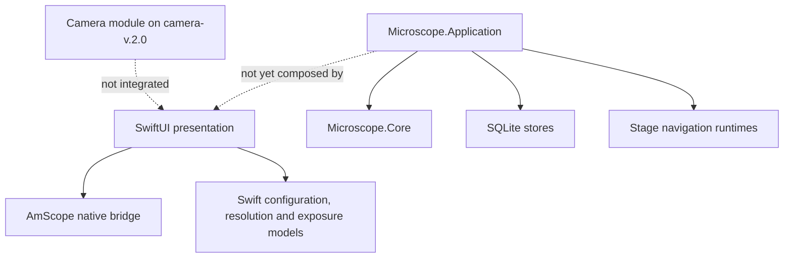
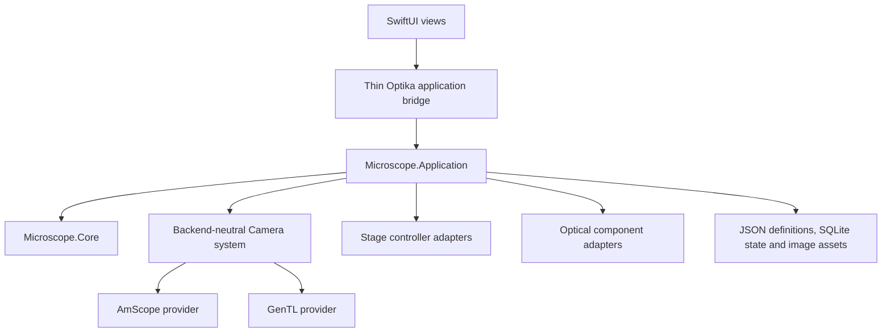

# Microscope Platform Completion Audit — v0.9

**Audit date:** 2026-11-27  
**Application branch:** `OPTIKA-B293-DUALSLIDE-APP-v.0.9`  
**Application code baseline:** `0d51df7b6e9c863c2e09ae25a2aeaf0c700a2e13`  
**Platform CI:** [run 45929942838](https://github.com/Shennagyp/MICROSCOPE_CPP/actions/runs/45929942838) — Ubuntu GCC, macOS Clang and Windows MSVC passed. The macOS job includes the native Optika application build and tests.

This audit distinguishes implemented domain contracts from executable hardware workflows. A model, resolver or transition plan is not evidence that a physical device can be commanded and verified.

## 1. Current dependency picture

The Optika branch currently links the C++ Core and Application targets, but the native SwiftUI bridge imports only the AmScope camera bridge. Microscope configuration, automatic resolution, objective/exposure coordination and capture-gallery behavior still live in Swift models. The C++ Application stores and stage runtimes are not yet composed into the native app.

The camera implementation with GenTL support is on a separate development line, `camera-v.2.0`; it is not present in the Optika branch.

Target dependency direction:

The target graph is not yet implemented. ImageProcessing remains a separate project; the microscope platform should define the acquisition/tile contract without absorbing image-processing algorithms.

## 2. Library status

### Microscope.Core

**Implemented and worth preserving**

- Immutable equipment topology: installed components, ports, physical connections, ordered optical paths and selectable LightPaths.
- Objective, camera, condenser, illumination and stage/axis specifications.
- Optical-function capabilities for phase annulus, DIC, polarizing, analyzer, filter, darkfield and related optical roles.
- Optical magnification resolution and camera output-mode sensor mapping.
- Versioned SampleType and physical Slide models. A Slide pins the exact SampleType revision, owns its code/geometry/preparation/stains and may reference an OriginLabId.
- Stain identity with optional advisory microscopy-suitability metadata.
- Operating-mode recommendation from the combination of SampleType and Stain. SampleType hard constraints govern eligibility; preferences rank candidates; Stain advice remains advisory.
- Intent/realization separation: `OperationMode` defines contrast intent only; `OperationModeHardwareConfiguration` holds optional, revision-bound LightPath hardware settings.
- LightPath calibration, selection-driven configuration resolution and a declarative configuration-transition dependency DAG.
- Stage-axis resolution/accuracy/repeatability/error-budget state, homing requirements, motion-port contracts, and dual-slide registration with four measured corners per slide.

**Structural work still required**

1. `SampleModels.h` imports `DualSlideNavigation.h` to obtain `SlideGeometry`. `OpticalTopology.h` also imports navigation to obtain `DualSlideCarrierSpecification`. These are dependency-direction inversions: sample and installed-equipment definitions should not depend on the navigation runtime header.
2. `StageWorkingSurface2D` defines a separate `SlideGeometry2D`. Establish one canonical physical slide-geometry value, or document a deliberate distinction between slide dimensions and working-surface placement.
3. The fixed physical `DualSlideCarrierState` (Left/Right slots and four-corner affine registration) and the newer `StageWorkingSurface2D` placement model are not yet joined by an explicit, lossless mapping. Do not replace the measured four-corner registration with a simpler drawn rectangle.
4. There is no Tile or acquisition-record model. The current domain contains Slide, not the `Slide -> Tile` acquisition relationship.
5. Equipment definitions are revisioned in memory, but there is no authoritative JSON loader or persisted equipment-definition repository. Calibration and carrier records refer to equipment revisions; those revisions must be reloadable and verifiable after restart.
6. Configuration resolution produces desired state and a transition DAG. It does not read a complete observed microscope state, skip already-satisfied changes, issue optical device commands or verify physical completion.
7. Stage-axis accumulated error and homing-required state exist in Core, but there is no explicit persistence/restart contract for them. On restart, the runtime must not treat a stale saved position as observed truth; define whether the axis must be re-homed or whether a controller can re-establish a verified reference.

The hardware is now genuinely modeled. The missing layer is the authoritative persisted definition plus live observations and execution—not another rewrite of the topology model.

### Microscope.Application

**Implemented**

- SQLite stores for SampleType/Slide, dual-slide carrier state, microscope modes/LightPath calibration, camera model catalog and camera-component model bindings.
- Versioned Slide persistence and exact revision checks.
- Runtime handles, operation projections, bounded feedback ingress, wake signaling and serialized runtime-worker primitives.
- Stage navigation runtime and working-surface navigation runtime with feedback correlation, position verification and fault handling.

**Missing for a UI-facing application library**

- A microscope-level composition root and use-case facade. There is no complete runtime that owns the equipment definition, device sessions, observed component state, mounted slides, current configuration and active operations together.
- A revisioned `MicroscopeSnapshot` (or equivalent) for the UI. Current RuntimeSnapshot/OperationView are not a complete microscope-state projection.
- JSON loading for equipment definitions and configuration profiles.
- A way to enumerate all current OperationModes from persistence; the configuration store loads a mode by ID but has no current-mode listing API. ConfigurationProfileCatalog also has no application persistence/loading path.
- A central SQLite migration/database owner. The dual-slide store currently relies on the SampleSlide store having initialized the shared database schema first.
- Concrete stage-controller and optical-component adapters. `IStageMotionPort` is a contract, not a driver.
- Complete cancellation/deadline/timeout handling, verified-idle semantics and late-completion reconciliation in the stage operation lifecycle.
- A configuration reconciler/executor that compares desired configuration to observed state, skips no-op changes, executes only required actions and verifies the result.

### Camera module

The Optika branch contains an older Common + AmScope arrangement and no `Camera/GenTL` target. The separate `camera-v.2.0` branch contains a newer Camera module package:

- Common frame layout includes image offset, row padding and trailing padding without rearranging payload bytes.
- PFNC packed representation includes Mono14p and Bayer 10p/12p/14p patterns; the GenTL adapter tests the packed Bayer patterns and layout metadata.
- GenTL producer discovery, device/session/data-stream lifecycle and optional official GenApi integration.
- AmScope backend and common feature-access contracts.
- Install/export rules and external-consumer package tests.

Relevant camera-line CI evidence:
- [GenTL C++ bridge run 45917806852](https://github.com/Shennagyp/MICROSCOPE_CPP/actions/runs/45917806852)
- [Camera module package/consumer run 45927150649](https://github.com/Shennagyp/MICROSCOPE_CPP/actions/runs/45927150649)
- [AmScope macOS driver run 45928851220](https://github.com/Shennagyp/MICROSCOPE_CPP/actions/runs/45928851220)

These are software/simulator CI results, not a physical CTI-camera qualification. GenTL copies a completed payload once into owned storage before requeueing the producer buffer; the Common adapter then moves that vector into the common Frame. There is no second adapter copy or payload rearrangement.

**Do not merge the camera branch wholesale.** The two development branches have substantially diverged. Import the Camera module as a controlled subtree at a pinned commit and adapt the Optika root CMake composition.

Before importing, reconcile two previously rejected scope items:
- `AcquisitionIntegrityTracker` is still used by both AmScope and GenTL and adds sequence/integrity accounting to the acquisition path. Keep it out of the Optika integration unless explicitly reconsidered.
- Optional Qt adapters, QtWidgets and the preview application still exist in the camera branch. The Optika application is SwiftUI; do not import or build these Qt components.

No separate `ValidatedSharedFrame` wrapper was found. The GenTL frame adapter validates layout metadata and produces the existing common Frame type.

The GenTL provider and AmScope enumerator exist, but there is not yet one backend-neutral provider/session facade for the application. The camera module should own discovery/open/stream/feature lifecycle and preserve each backend's opaque descriptor/producer ownership. The UI must not reconstruct a GenTL descriptor from display metadata.

One GenTL header comment is inconsistent with its implementation: `ProducerCatalog::discoverDevices` documentation says the Producer is closed, while the returned catalog entry retains the Producer instance. Correct this ownership documentation during integration.

AmScope SDK redistribution rights remain a release/distribution question; local development runtime copying is not evidence of redistribution permission.

### Controller and acquisition libraries

- No concrete Controller target/driver is present on the Optika branch. Core has `IStageMotionPort` and Application has stage runtimes, but no adapter for the installed controller protocol.
- No slide-scanning/acquisition library or Tile persistence is present on this branch.
- The Native capture gallery writes image files using `NativeSlideID` (a presentation-pane identity), not the physical `SlideId`/Tile identity. It is not a WSI tile store.
- Keep ImageProcessing separate. Define the Tile metadata and image-asset boundary, then let the scanning/application layer orchestrate stage + camera capture.

## 3. Native application status

The native app builds, but its domain responsibilities are not yet thin presentation:

- The bridging header imports the AmScope native bridge, not a Microscope.Application bridge.
- Swift owns microscope configuration persistence through UserDefaults.
- Automatic resolution and objective/exposure coordination remain Swift-side. The current Rayleigh policy uses a wavelength band and a target sampling factor, but derives mode scaling from a provisional full-field width/height ratio. Move this policy to Core and use the camera output mode's explicit per-axis sensor-pixel mapping; do not infer X/Y sampling from output dimensions alone.
- The capture gallery uses a global AmScope capture directory rather than a selected physical-slide folder and Tile record. `NativeSlideID` identifies a presentation pane, not the physical `SlideId`.

The existing preview, feature controls and workspace shell can remain as presentation. Do not add more UI behavior until the C++ application API owns the domain workflows and the UI consumes immutable snapshots/events.

## 4. Completion order

1. Keep the three-platform CI baseline green.
2. Fix Core ownership boundaries: extract shared SlideGeometry and static DualSlideCarrierSpecification from navigation; reconcile the two slide-geometry types and the physical-carrier/working-surface mapping.
3. Import the camera-v2.0 Camera package as a controlled subtree. Exclude AcquisitionIntegrityTracker and Qt components; fix ProducerCatalog ownership documentation; add one backend-neutral provider/session API over AmScope and GenTL.
4. Add authoritative equipment-definition JSON loading and revision persistence. Add mode/profile enumeration/loading and a central database migration owner.
5. Compose a microscope-level Application runtime and UI-facing snapshots/events. Integrate SampleType + Stain -> recommended OperationMode -> explicit selection -> desired/observed state reconciliation.
6. Implement and test concrete stage and optical component adapters. Preserve stage error accumulation/homing behavior; complete cancellation, timeout, verified-idle and late-completion handling.
7. Add the Slide -> Tile acquisition contract and single-tile capture/persistence workflow. Keep image bytes in file/asset storage, not in Core; keep ImageProcessing separate.
8. Move Rayleigh-based automatic-resolution policy and objective/exposure orchestration behind Core/Application contracts, using the explicit per-axis camera output mapping.
9. Replace Swift domain logic with a thin native bridge to Microscope.Application.

## 5. UI-readiness acceptance gate

Build one complete vertical slice before treating the libraries as a UI foundation:

1. Load the Optika B293 equipment definition and exact revision.
2. Discover AmScope and GenTL cameras through the same Camera API; preserve backend session ownership.
3. Load a physical Slide with exact SampleType revision and optional Stain metadata.
4. Recommend an OperatingMode from SampleType + Stain and expose the reason/evidence to the UI.
5. Compare desired contrast intent with observed hardware state; do nothing if already satisfied, otherwise execute only required optical actions and verify them.
6. Home/move the stage through an adapter, preserving the physical dual-slide four-corner registration and position-error budget.
7. Capture one Tile into the selected slide folder with camera mode, optical configuration, equipment revision, stage transform and acquisition metadata.
8. Publish immutable microscope/operation snapshots and events to SwiftUI.

Run this vertical slice with fake camera, stage and optical adapters in CI. Hardware smoke tests remain separate. Once this works, the UI can be built without duplicating microscope rules or persistence.
