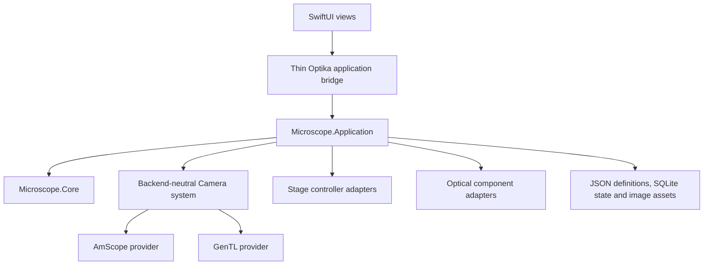

# Microscope Platform Completion Audit — v0.9

**Audit date:** 2026-11-27  
**Application branch:** `OPTIKA-B293-DUALSLIDE-APP-v.0.9`  
**Application code baseline:** `bbc426463866950883248ebff8dbf04c71051412`  
**Previous platform baseline:** [run 45943921361](https://github.com/Shennagyp/MICROSCOPE_CPP/actions/runs/45943921361) passed Ubuntu GCC, macOS Clang and Windows MSVC. **Current comparison + CAD persistence changes:** [run 45952613208](https://github.com/Shennagyp/MICROSCOPE_CPP/actions/runs/45952613208) is pending; do not treat the new store as verified until this run completes.

This audit distinguishes implemented domain contracts from executable hardware workflows. A model, resolver or transition plan is not evidence that a physical device can be commanded and verified.

## 1. Current dependency picture

The Optika branch currently links the C++ Core and Application targets, but the native SwiftUI bridge imports only the AmScope camera bridge. Swift already owns the application acquisition workflow, including capture orchestration, slide-folder/image organization and gallery lifecycle; this is an established application responsibility, not a missing C++ library feature. Microscope configuration, automatic resolution and objective/exposure coordination also remain Swift-side today. The C++ Application stores and stage runtimes are not yet composed into the native app.

The camera implementation with GenTL support is on a separate development line, `camera-v.2.0`; it is not present in the Optika branch.

```mermaid
flowchart TD
    UI[SwiftUI presentation]
    CamBridge[AmScope native bridge]
    SwiftApp[Swift application: acquisition workflow, capture orchestration, image/tile organization and gallery]\n    SwiftRules[Swift microscope configuration, resolution and exposure models]
    Core[Microscope.Core]
    App[Microscope.Application]
    Stores[SQLite stores]
    StageRuntime[Stage navigation runtimes]
    CamV2[Camera module on camera-v.2.0]
    UI --> CamBridge
    UI --> SwiftRules
    App --> Core
    App --> Stores
    App --> StageRuntime
    CamV2 -. not integrated .-> UI
    App -. not yet composed by .-> UI
```

Target dependency direction:



The target graph is not yet implemented. Swift is the owner of the application-level acquisition workflow and durable image/tile organization. Camera-v2.0 supplies the camera-side discovery, session, streaming and frame-delivery capability (including its advanced preview pipeline); it does not need to absorb microscope acquisition policy. ImageProcessing remains a separate project. C++ Core/Application should expose microscope hardware and domain capabilities to Swift rather than duplicate the Swift acquisition lifecycle.

## 2. Library status

### Microscope.Core

**Implemented and worth preserving**

- Immutable equipment topology: installed components, ports, physical connections, ordered optical paths and selectable LightPaths.
- Objective, camera, condenser, illumination and stage/axis specifications.
- Optical-function capabilities for phase annulus, DIC, polarizing, analyzer, filter, darkfield and related optical roles.
- Optical magnification resolution and camera output-mode sensor mapping.
- Versioned SampleType and physical Slide models. A Slide pins the exact SampleType revision, owns its code/geometry/preparation/stains and may reference an OriginLabId.
- Stain identity with optional advisory microscopy-suitability metadata.
- Operating-mode recommendation from the combination of SampleType and Stain. SampleType hard constraints govern eligibility; preferences rank candidates; Stain advice remains advisory.
- Intent/realization separation: `OperationMode` defines contrast intent only; `OperationModeHardwareConfiguration` holds optional, revision-bound LightPath hardware settings.
- LightPath calibration, selection-driven configuration resolution and a declarative configuration-transition dependency DAG.
- Stage-axis resolution/accuracy/repeatability/error-budget state, homing requirements, motion-port contracts, and dual-slide registration with four measured corners per slide.

**Structural work still required**

1. **Completed and CI-verified:** `SlideGeometry` belongs to the sample domain, and `DualSlideCarrierSpecification` belongs to equipment. `SampleModels.h` and `OpticalTopology.h` no longer import `DualSlideNavigation.h`. Navigation owns the conversion from a registered slide-local target to a stage motion command. The extraction preserves four-corner registration and axis-unit conversion. The successful platform run is [45943921361](https://github.com/Shennagyp/MICROSCOPE_CPP/actions/runs/45943921361).
2. **Geometry value reconciliation implemented:** sample-domain `SlideGeometry` stores axis-neutral local X/Y extents. `StageWorkingSurface2D::SlideGeometry2D` is a stage-local semantic adapter over that canonical value, with no duplicate dimension storage or validation; its length/width names map to local X/Y. Existing width/height accessors remain compatibility aliases. The adapter is covered by a Core test.
3. **Comparison and CAD persistence implemented; current CI pending:** `Microscope.Application::SlideRegistrationWorkingSurfaceComparison` explicitly binds one physical `SlideId` and its four measured corners to one CAD placement through a validated `SlideCornerCorrespondence`. It checks stage-component and axis identity, supports direct or swapped stage-axis ordering and rotated/reflected local-corner orientation, and reports raw per-corner CAD-minus-measured deltas, correspondence-aware physical/CAD extent differences, both revision identities, revision alignment, original measurement provenance/uncertainty and registration fit residuals. The correspondence must be an explicit cyclic rotation or reflection; no corner is inferred from the Left/Right carrier slot. The comparison snapshot owns immutable copies of both source models, so the original affine `toStage`/`toSlide` mapping, CAD drawing handles and constraints remain available. It neither replaces the affine registration nor issues stage commands. A differing geometry or revision is reported, not silently normalized or overwritten.\n\n   `StageWorkingSurfaceSqliteStore` now persists the CAD working-surface snapshot and exactly one explicit corner correspondence per slide in append-only, equipment-revision-bound records. Parent surface revisions and child slide-placement/correspondence rows are immutable after publication, and child rows cannot be appended to a published revision; a current-revision pointer advances monotonically under an optimistic expected-revision check. Reload validates the persisted axes, units, stage travel, rectangle geometry, and correspondence bijections against the installed `StageSpecification`. The measured physical carrier registration remains in `DualSlideCarrierSqliteStore`; no measured corners or affine calibration are duplicated in the CAD layout store.
4. There is no Core Tile/acquisition-record model. This is not currently classified as a missing platform feature: the established Swift application owns acquisition workflow and image/tile organization. Add a Core Tile value only if microscope-domain semantics (for example, stage-space tile identity or registration) must be shared independently of the Swift application; do not duplicate image/tile persistence merely to mirror the UI workflow.
5. Equipment definitions are revisioned in memory, but there is no authoritative JSON loader or persisted equipment-definition repository. Calibration and carrier records refer to equipment revisions; those revisions must be reloadable and verifiable after restart.
6. Configuration resolution produces desired state and a transition DAG. It does not read a complete observed microscope state, skip already-satisfied changes, issue optical device commands or verify physical completion.
7. Stage-axis accumulated error and homing-required state exist in Core, but there is no explicit persistence/restart contract for them. On restart, the runtime must not treat a stale saved position as observed truth; define whether the axis must be re-homed or whether a controller can re-establish a verified reference.

The hardware is now genuinely modeled. The missing layer is the authoritative persisted definition plus live observations and execution—not another rewrite of the topology model.

### Microscope.Application

**Implemented**

- SQLite stores for SampleType/Slide, dual-slide carrier state, microscope modes/LightPath calibration, camera model catalog and camera-component model bindings.
- Versioned Slide persistence and exact revision checks.
- Runtime handles, operation projections, bounded feedback ingress, wake signaling and serialized runtime-worker primitives.
- Stage navigation runtime and working-surface navigation runtime with feedback correlation, position verification and fault handling.
- Physical-registration/CAD-placement comparison with explicit corner correspondence, axis identity checks, per-corner discrepancy reporting and retained calibration evidence.\n- Revisioned `StageWorkingSurfaceSqliteStore` for CAD layout plus per-slide correspondence, with equipment-revision binding, optimistic concurrency, immutable history, validation on reload, and a dedicated persistence test target. The comparison and new persistence tests are included in current CI run [45953056200](https://github.com/Shennagyp/MICROSCOPE_CPP/actions/runs/45953056200); result pending.

**Missing for a UI-facing application library**

- A microscope-level composition root and use-case facade. There is no complete runtime that owns the equipment definition, device sessions, observed component state, mounted slides, current configuration and active operations together.
- A revisioned `MicroscopeSnapshot` (or equivalent) for the UI. Current RuntimeSnapshot/OperationView are not a complete microscope-state projection.
- JSON loading for equipment definitions and configuration profiles.
- ConfigurationProfileCatalog still has no application persistence/loading path. Current OperationMode enumeration is now implemented through `MicroscopeConfigurationSqliteStore::loadCurrentOperationModes(microscopeId)`; it returns one current revision per ID in stable order and scopes results to one microscope.
- A central SQLite migration/database owner. The CAD working-surface store owns a separate schema version and does not depend on SampleSlide initialization; the existing dual-slide store still relies on the SampleSlide store having initialized the shared database schema first.
- Concrete stage-controller and optical-component adapters. `IStageMotionPort` is a contract, not a driver.
- Complete cancellation/deadline/timeout handling, verified-idle semantics and late-completion reconciliation in the stage operation lifecycle.
- A configuration reconciler/executor that compares desired configuration to observed state, skips no-op changes, executes only required actions and verifies the result.

### Camera module

The Optika branch contains an older Common + AmScope arrangement and no `Camera/GenTL` target. The separate `camera-v.2.0` branch contains a newer Camera module package:

- Common frame layout includes image offset, row padding and trailing padding without rearranging payload bytes.
- PFNC packed representation includes Mono14p and Bayer 10p/12p/14p patterns; the GenTL adapter tests the packed Bayer patterns and layout metadata.
- GenTL producer discovery, device/session/data-stream lifecycle and optional official GenApi integration.
- AmScope backend and common feature-access contracts.
- Install/export rules and external-consumer package tests.

Relevant camera-line CI evidence:
- [GenTL C++ bridge run 45917806852](https://github.com/Shennagyp/MICROSCOPE_CPP/actions/runs/45917806852)
- [Camera module package/consumer run 45927150649](https://github.com/Shennagyp/MICROSCOPE_CPP/actions/runs/45927150649)
- [AmScope macOS driver run 45928851220](https://github.com/Shennagyp/MICROSCOPE_CPP/actions/runs/45928851220)

These are software/simulator CI results, not a physical CTI-camera qualification. GenTL copies a completed payload once into owned storage before requeueing the producer buffer; the Common adapter then moves that vector into the common Frame. There is no second adapter copy or payload rearrangement.

**Do not merge the camera branch wholesale.** The GitHub comparison reports a 795/472-commit divergence between the two lines. Import the Camera module as a controlled subtree at a pinned commit and adapt the Optika root CMake composition.

Before importing, reconcile two previously rejected scope items:
- `AcquisitionIntegrityTracker` is still used by both AmScope and GenTL and adds sequence/integrity accounting to the acquisition path. Keep it out of the Optika integration unless explicitly reconsidered.
- Optional Qt adapters, QtWidgets and the preview application still exist in the camera branch. The Optika application is SwiftUI; do not import or build these Qt components. The older AmScope CMake setup on the Optika branch also defaults its Qt adapter and preview options to ON; do not carry that default into the integrated package.

No separate `ValidatedSharedFrame` wrapper was found. The GenTL frame adapter validates layout metadata and produces the existing common Frame type.

The GenTL provider and AmScope enumerator exist, but there is not yet one backend-neutral provider/session facade for the application. The camera module should own discovery/open/stream/feature lifecycle and preserve each backend's opaque descriptor/producer ownership. The UI must not reconstruct a GenTL descriptor from display metadata.

One GenTL header comment is inconsistent with its implementation: `ProducerCatalog::discoverDevices` documentation says the Producer is closed, while the returned catalog entry retains the Producer instance. Correct this ownership documentation during integration.

AmScope SDK redistribution rights remain a release/distribution question; local development runtime copying is not evidence of redistribution permission.

### Controller and acquisition libraries

- No concrete Controller target/driver is present on the Optika branch. Core has `IStageMotionPort` and Application has stage runtimes, but no adapter for the installed controller protocol.
- No slide-scanning/acquisition library or Tile persistence is present on this branch.
- The Native capture gallery writes image files using `NativeSlideID` (a presentation-pane identity), not the physical `SlideId`/Tile identity. It is not a WSI tile store.
- Keep ImageProcessing separate. Define the Tile metadata and image-asset boundary, then let the scanning/application layer orchestrate stage + camera capture.

## 3. Native application status

The native app builds. Its acquisition workflow is an intentional Swift application responsibility and should remain there. The remaining boundary issue is not to move acquisition into C++; it is to make the C++ platform services available to the Swift application so its existing workflow can operate against authoritative microscope state. Current integration observations:

- The bridging header imports the AmScope native bridge, not a Microscope.Application bridge.
- Swift owns microscope configuration persistence through UserDefaults.
- Automatic resolution and objective/exposure coordination remain Swift-side. The current Rayleigh policy uses a wavelength band and a target sampling factor, but derives mode scaling from a provisional full-field width/height ratio. Move this policy to Core and use the camera output mode's explicit per-axis sensor-pixel mapping; do not infer X/Y sampling from output dimensions alone.
- The Swift acquisition workflow and gallery are application-owned. Verify during integration that the workflow's physical Slide identity is sourced from `SlideId`, while `NativeSlideID` remains only a presentation-pane identity; do not conflate the two. Image/tile file organization remains Swift-owned.

The existing preview, feature controls and workspace shell can remain as presentation. The established Swift acquisition workflow remains application-owned; the C++ application API should expose microscope-domain state and hardware services without absorbing capture orchestration or image/tile persistence.

## 4. Completion order

1. Keep the three-platform CI baseline green; verify the new registration/working-surface comparison and its Application tests in the current workflow before proceeding.
2. **Implemented:** compare physical four-corner carrier registration with CAD working-surface placement through an explicit corner correspondence. Next, persist that correspondence with the versioned working-surface configuration and validate its reload/stale-revision behavior. Do not flatten affine registration, measured corner provenance, fit residuals or either revision into the orthogonal CAD rectangle.
3. Import the camera-v2.0 Camera package as a controlled subtree. Exclude AcquisitionIntegrityTracker and Qt components; fix ProducerCatalog ownership documentation; add one backend-neutral provider/session API over AmScope and GenTL.
4. Add authoritative equipment-definition JSON loading and revision persistence. Add mode/profile enumeration/loading and a central database migration owner.
5. Compose a microscope-level Application runtime and UI-facing snapshots/events. Integrate SampleType + Stain -> recommended OperationMode -> explicit selection -> desired/observed state reconciliation.
6. Implement and test concrete stage and optical component adapters. Preserve stage error accumulation/homing behavior; complete cancellation, timeout, verified-idle and late-completion handling.
7. Move Rayleigh-based automatic-resolution policy and objective/exposure orchestration behind Core/Application contracts, using the explicit per-axis camera output mapping.
8. Integrate the existing Swift acquisition workflow with the C++ microscope facade: pass physical Slide identity, use camera sessions and stage/optical commands, and consume verified state/events. Keep capture orchestration, image/tile organization, file persistence and gallery lifecycle in Swift.
9. Replace only duplicated microscope-domain logic in Swift with calls to Microscope.Application; do not move the Swift acquisition workflow into C++.

## 5. UI-readiness acceptance gate

Build one complete vertical slice before treating the libraries as a UI foundation:

1. Load the Optika B293 equipment definition and exact revision.
2. Discover AmScope and GenTL cameras through the same Camera API; preserve backend session ownership.
3. Load a physical Slide with exact SampleType revision and optional Stain metadata.
4. Recommend an OperatingMode from SampleType + Stain and expose the reason/evidence to the UI.
5. Compare desired contrast intent with observed hardware state; do nothing if already satisfied, otherwise execute only required optical actions and verify them.
6. Home/move the stage through an adapter, preserving the physical dual-slide four-corner registration and position-error budget.
7. Capture one Tile into the selected slide folder with camera mode, optical configuration, equipment revision, stage transform and acquisition metadata.
8. Publish immutable microscope/operation snapshots and events to SwiftUI.

Run this vertical slice with fake camera, stage and optical adapters in CI while exercising the existing Swift acquisition coordinator against the platform facade. Hardware smoke tests remain separate. The acceptance criterion is a stable platform contract beneath the existing application workflow—not a second C++ implementation of that workflow.
